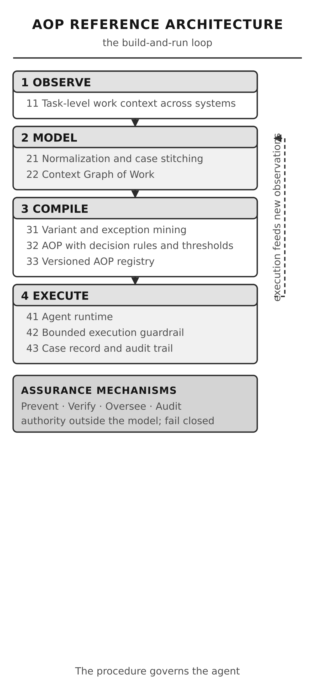

# Agentic Operating Procedure

Agentic Operating Procedure is an engineering and operational blueprint for specifying, governing and assuring operational execution by agents that interpret context and act. 
The concept of an agent here is compatible with Russell and Norvig (1995) definition, as “anything that can be viewed as perceiving its environment through sensors and acting upon that environment through effectors.”.

AOP establishes the intent, decision rights, execution constraints and assurance obligations under which an agent may work, and the evidence that shows the work was done correctly.

The purpose is not to automate a documented procedure, like the classic standard operating procedure (SOP) for agents through agent skill adaptation. It is to make delegated operational execution inspectable: to state, before execution, who may decide what, under which constraints, and with what proof of outcome.

[Read the founding paper](https://github.com/agentic-operating-procedure/aop-foundations/blob/main/docs/aop-founding-paper-concept-scope.md) | [Explore the GitHub organisation](https://github.com/agentic-operating-procedure)

---

## The discipline

Operational work has always been described in documents. A Standard Operating Procedure states an approved method: a linear corridor with prescribed steps, a named owner, and an assumed human reader who notices what the document missed. That model works until the work stops being linear, until exceptions are common rather than exceptional, and until the executor is a machine that cannot notice anything at all.

Agentic Operating Procedure is the discipline that emerged from that gap. It specifies operating intent rather than a fixed sequence of activities; it states decision rights explicitly, so that an agent's authority is bounded by a document rather than by the shape of its implementation; it requires an evidence record per case, so that correctness is checkable rather than asserted; and it compiles the procedure from observed work, so that coverage is measured rather than hoped for.

Agentic Operating Procedure is not an AI framework, not a workflow engine, not a policy language, and not a deployment topology. It is the specification layer that sits above all of those and below none of them. It is equally applicable to a rules-based executor and a model-driven one.

The discipline brings together:

- **Operating intent**: the objective and the context in which the objective is pursued, stated so that an executor can interpret rather than merely comply.
- **Decision rights**: the explicit boundary between decisions an agent may take alone and decisions that require a human, expressed per decision rather than per system.
- **Execution constraints**: the policies, prohibitions and limits in force, evaluated outside the executor's own context so the executor cannot influence the outcome of the check that governs it.
- **Reusable capability**: Agent Skills, atomic and independently testable, carrying no authority of their own.
- **Controlled execution**: the Domain Agent Harness, the environment in which an agent acts, and which is itself the top-level AOP for its domain.
- **Evidence and assurance**: the append-only case record, the provenance chain back to observed cases, and the conformance and evaluation regimes that test the claim.

These concerns apply across the full operating surface: from a single regulated workflow to an estate of delegated operational agents.

## Reference architecture

The reference architecture is a versioned artefact describing how AOP is implemented as an end-to-end engineering system, from observed work to a verified, evidenced outcome and back to a revised specification.

### The engineering lifecycle

| Stage | Work items | Responsibility |
|---|---|---|
| 01. Observe | W1 | Capture task-level work context across systems, including the cross-application and legacy interactions that never appear in API logs. |
| 02. Model | W2, W3 | Normalize events and stitch them into end-to-end cases, building the Context Graph of Work: steps, actors, systems, decisions, exceptions and outcomes, with frequencies and evidence attached to every edge. |
| 03. Compile | W4, W5, W6 | Mine the graph into an AOP: enumerate variants with observed frequencies, extract decision rules and thresholds, identify exception and escalation patterns, attach governance bounds, and version the result so every rule carries provenance back to observed cases. |
| 04. Execute | W7, W8, W9 | Agents run against the AOP under a bounded-execution guardrail. Every action appends to a case-level audit record, and execution itself becomes new observation, closing the loop. |

The bounded execution guardrail sits inside the execute stage, not beside it: it is a policy decision point and a policy enforcement point that sit outside the model's context. The agent can only propose actions; the guardrail approves, blocks or escalates them. An agent cannot self-authorize, because the permission check runs where the model cannot reach.

Four assurance mechanisms apply across the stages rather than belonging to any one of them.

| Mechanism | Meaning |
|---|---|
| Prevent | Authority lives outside the model. Each action executes under short-lived credentials scoped to that action class. |
| Verify | Fail closed against observed paths. A known pattern within authority executes, a known pattern beyond authority requests approval, and an unknown condition escalates. |
| Oversee | Approvals arrive as evidence bundles carrying the proposed action, the triggering rule, its provenance, the baseline comparison and the case context. |
| Audit | Every decision is replayable. Each action appends to an append-only, tamper-evident case record. |

The architecture is a reference model, not a mandate to adopt a particular vendor, model, framework or deployment topology.

### The narrower view: the six-level hierarchy

The reference architecture describes the broader source-to-outcome lifecycle. The six-level hierarchy describes the conceptual structure within it. They are complementary views, not competing architectural definitions.

| Level | Architectural responsibility |
|---|---|
| Agentic Operating Engineering | The discipline |
| Agentic Operating Procedure | The operational specification |
| Agent Skill | The reusable capability |
| Domain Agent Harness | The controlled execution environment |
| Agent | The execution actor |
| Agentic Operations | The broader operating mode |

Read downwards, the ladder is a discipline. Read upwards, it is a containment: the operating mode contains agents, agents run inside a harness, a harness is governed by an AOP, an AOP invokes skills, and the apparatus expresses the discipline.

## Core engineering concepts

### The operating specification

An Agentic Operating Procedure populates eight mandatory dimensions: intent, context, constraints, authority, capabilities, coordination, control and assurance. A document that omits one is not a degraded AOP; it is not an AOP. The eight dimensions are the normative contract, and their content is domain-specific.

The structure is network-native. A procedure contains variants with observed frequencies, decision points with the rule that governs them, exception edges, and rework loops. A linear procedure is a special case with one variant and no exceptions, and it is precisely the case the concept was built to escape.

### The decision-rights contract

Every decision the executor may take alone is written down, separately from what happens. The authority check that enforces this boundary is performed by a component outside the executor's context, so the executor cannot influence the outcome of the check that governs it. A decision that crosses the boundary produces an escalation, not an action.

### The evidence contract

Every case produces an append-only record: the context snapshot, the matched variant, the rule applied, the provenance, the decision, the approver where one was required, and the outcome. Logging is retrospective and best-effort. An evidence contract is specified in advance, and it is the difference between a claim of correctness and a checkable one.

### Provenance

A published artefact traces back to the observed cases it was compiled from. Provenance is what makes coverage measurable: the variants in a procedure carry observed frequencies, so the gap between the documented procedure and the actual work is a number rather than an opinion.

### The three burdens of proof

| Level | Meaning | Verified by |
|---|---|---|
| Declared | What the programme says AOP means | Internal consistency and reasoning |
| Certified | The document conforms to the AOP specification | Machine validation against the schema and the conformance clauses |
| Demonstrated | It works, and here is the evidence | Reproduction by a third party from published artefacts |

A concept needs all three. The first alone is an opinion. The first two are a standard. All three are a discipline other people can build on without asking permission.

## The discipline repository

Agentic Operating Procedure is developed through a collection of repositories with explicit artefact ownership.

Each repository has one authoritative responsibility. Other repositories reference its outputs rather than maintaining competing copies of canonical definitions or specifications.

### Foundations and governance

| Repository | Responsibility |
|---|---|
| [`aop-governance`](https://github.com/agentic-operating-procedure/aop-governance) | Change control: decisions, change requests, findings, the lifecycle model, the release policy, the contributor rules, and the programme plan. |
| [`aop-foundations`](https://github.com/agentic-operating-procedure/aop-foundations) | The concept: the founding paper, the six-level hierarchy, the glossary, the non-goals. |
| [`aop-landscape`](https://github.com/agentic-operating-procedure/aop-landscape) | Positioning: the claim-by-claim differentiation table, the prior-art survey, the standards landscape. |

### Models, specifications and architecture

| Repository | Responsibility |
|---|---|
| `aop-spec` | The normative authority: the eight-dimension model, the network-native structure, the identifier scheme, the machine-readable schema, the Agent Skill contract annex, the conformance clauses. |
| `aop-architecture` | The reference architecture: the layered view, the trust model, the compile-and-run pipeline, the deployment topologies, the threat model. |

### Implementation and assurance

| Repository | Responsibility |
|---|---|
| `aop-context-graph` | The Context Graph of Work: the entity model, case stitching, the digital twin, drift detection. |
| `aop-toolkit` | Reusable engineering utilities: the SOP parser, the AOP linter, the variant miner, the decision-rule compiler, the generator, the SDK. |
| `aop-reference-harness` | The working reference implementation: the runtime loop, the guardrail, scoped credentials, escalation dispatch, the evidence bundle, the append-only case record. |
| `aop-registry` | The versioned catalogue of published procedures, skills and harnesses, with discovery, dependency resolution and provenance. |
| `aop-conformance` | The validation regime: the conformance profiles, the test fixtures including deliberately broken procedures, the certification process. |
| `aop-evaluation` | The burden of proof: human baselines, shadow-mode comparison, the metric set, the reproducibility protocol. |

### Practice and adoption

| Repository | Responsibility |
|---|---|
| `aop-adoption` | The implementation playbook, the SOP-to-AOP migration path, the maturity model, the adoption scenarios, the organisational change guidance. |
| `aop-examples` | Worked exemplars taken end to end from a standard procedure to an audited agent action. |

`aop-governance` remains the canonical entry point for the programme and its change process.

## How the discipline evolves

Agentic Operating Procedure evolves through explicit proposals, technical review and evidence-backed changes.

The governance process distinguishes five change classes: foundational changes to a defined term or the shape of the hierarchy; normative specification changes; architectural decisions; implementation changes; and experimental research. Each has its own review path, and a change that touches more than one class is split before it is reviewed.

Changes to canonical definitions and technical contracts are reviewed in their authoritative repositories. Implementations and conformance tests evolve against versioned specifications.

The objective is to maintain conceptual coherence while allowing the discipline to improve through research, implementation experience and independent scrutiny.

Start with [`aop-governance`](https://github.com/agentic-operating-procedure/aop-governance) to understand the change process.

## Contributing

Agentic Operating Procedure is intended to be open to technical scrutiny and contributions.

You can contribute by:

- Reviewing the principles and foundational definitions.
- Proposing changes to the model, the specification and the architecture.
- Implementing reference components and reusable tooling.
- Developing conformance tests and reproducible evaluations.
- Publishing research findings and documented case studies.
- Improving practitioner guidance and adoption material.

Begin with the repository that owns the artefact you want to change. Use its contribution guidance and the organisation's governance process for changes that affect more than one part of the discipline.

## Foundational writing

- [`aop-foundations` founding paper](https://github.com/agentic-operating-procedure/aop-foundations/blob/main/docs/aop-founding-paper-concept-scope.md): the origin of the concept, its structural difference from the Standard Operating Procedure, and the architecture of an AOP.
- [`aop-landscape` differentiation table](https://github.com/agentic-operating-procedure/aop-landscape/blob/main/docs/aop-differentiation-landscape-scope.md): what the concept states that adjacent disciplines do not, claim by claim, with the reasoning marked where it is the programme's own argument.

The essays establish the intellectual direction. The repositories progressively translate that direction into formal models, engineering contracts, implementations and evaluable practice.

## Guiding principle

The procedure governs the agent. From operating intent to governed execution, from decision rights to an evidence record, from a compiled procedure to a checkable outcome.

Agentic Operating Procedure exists to make that chain an explicit engineering concern.
